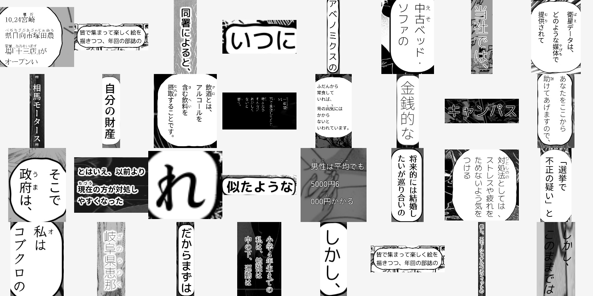
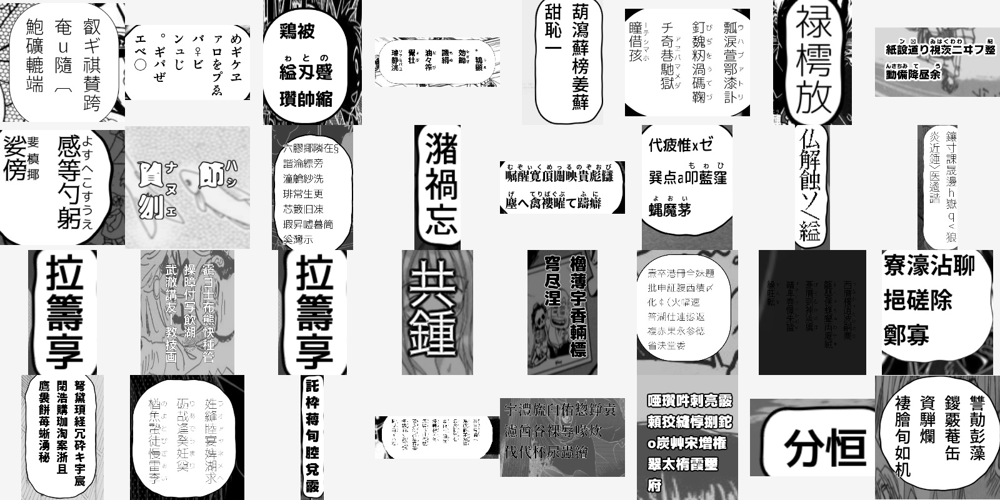

# Synthetic data generator

Generation of synthetic image-text pairs imitating Japanese manga for the purpose of training OCR.

Features:
- using either text from corpus or random text
- text overlaid on background images
- drawing text bubbles
- various fonts and font styles
- variety of text layouts:
  - vertical and horizontal text
  - multi-line text
  - [furigana](https://en.wikipedia.org/wiki/Furigana) (added randomly)
  - [tate chū yoko](https://www.w3.org/International/articles/vertical-text/#tcy)
  - irregular hand-lettered crops (sampled for ~35% of images, split evenly
    between mild and strong): per-line font sizes with staggered line starts,
    plus optional per-character emphasis sizing, baseline wobble, slight tilt
    and shrunken small kana. Force with `override_css_params={"irregular": ...}`
    and tune via `line_scale_min/max`, `line_shift`, `char_scale_min/max`,
    `char_jitter_prob`, `wobble`, `rotate`, `small_kana`.
  - whole-block slant (sampled for ~12% of images, a third of them strongly
    at 20–32°): italic-like skew applied to the composited text layer, so
    stroke outlines and shadows stay aligned. Force/tune with
    `override_css_params={"slant": degrees}`.
  - coloured text (sampled for ~60% of dialogue images and ~70% of SFX):
    red, hot pink, orange, yellow, green, lime, cyan, blue, purple, magenta,
    brown and light pink, with pink weighted heavily. A good share of coloured
    images mixes several colours within one image — `per_line` paints each
    column/row its own colour (emphasis lettering), `per_char` paints every
    glyph its own colour (rainbow SFX). Coloured samples are saved as colour
    (3-channel BGR) images so the hue survives; black/white samples stay
    grayscale. Legibility is computed programmatically (WCAG contrast):
    light fills automatically get a black outline, dark fills a white one, so
    even neon yellow/cyan stays readable on white bubbles. Force with
    `override_css_params={"text_color": "pink"}` (hex works too),
    `{"color_mode": "per_char", "text_colors": ["red", "yellow", "cyan"]}`,
    and tune via `COLOR_PROB` / `SFX_COLOR_PROB` / `MULTICOLOR_PROB` /
    `SFX_MULTICOLOR_PROB` in `renderer.py`.
- SFX split (separate dataset, `run(..., split="sfx")` → `img_sfx/` +
  `meta_sfx/` with `source=sfx`): short onomatopoeia (`ドン`, `ズキュン`,
  `はぁ`, `ぐちゅ`…) rendered huge (90–150 px) with curved baselines
  (`arc`/`wave`/`diagonal`/`straight`), true per-glyph perspective warps,
  per-glyph size/tilt, thick white outlines with optional black-outer
  double edges, radiating speedlines and jagged burst balloons behind the
  text, plus optional whole-block rotation. No furigana, no dialogue
  bubbles. Only font-rendered glyphs are labeled — `♡♥★` survive in the GT
  only as characters in the string, never as decorative shapes. Force with
  `generator.process(sfx=True)` / `override_css_params={"sfx": True}` and
  tune via `sfx_curve`, `sfx_curve_amp`, `sfx_persp`, `sfx_rotate`,
  `sfx_speedlines`, `sfx_burst`, `sfx_double_outline`, `sfx_block_rotate`.
  Diversity/accuracy notes for the SFX split:
  - ~200 base onomatopoeia (impact, breakage, motion, ambient, emotion, body
    reactions, soft hiragana SFX) combined procedurally: stretched vowels
    (`ドン` → `ドォン`), repeats/stutters (`ドドドン`), compounds, hiragana ↔
    katakana script variants, elongation (`ー`, `〜`, `ッ`) and mark tails
    (`!?`, `♡`, `...`). The ellipsis is spelled `...` in the GT, like dialogue.
  - Every candidate is checked against the font's supported characters and is
    rejected, never truncated, so the label always equals the drawn glyphs.
  - Fonts: only fonts that cover the SFX kana are sampled (a font without kana
    used to draw tofu boxes under a valid-looking label); `special`/`common`
    fonts are weighted up.
  - 7 baseline curves (`arc`, `wave`, `diagonal`, `straight`, `zigzag`,
    `bounce`, `hill`), per-glyph stretch (`sfx_aspect`), letter spacing from
    tight to airy, white ink with a black edge, and radial or parallel
    (`sfx_speedline_style`) speedlines.
  - Two-line vertical SFX are now laid out right-to-left, so line 1 of the GT
    is the right-hand column (it used to be reversed).


Text rendering is done directly with [Pillow](https://pillow.readthedocs.io/)
(no browser, no subprocesses, no temp files). The renderer typesets the same
layouts the old Chrome-based pipeline produced: vertical (`vertical-rl`) and
horizontal text, furigana (`<ruby>`), tate-chu-yoko
(`text-combine-upright`), `upright` vs. `mixed` Latin orientation, white
stroke outlines and glow shadows, on a transparent background. Fonts are
cached in memory, so rendering one image takes ~10-25 ms for the text layer
(~45 ms end-to-end incl. background/bubble on an i5-6500T), versus ~1.6 s per
image with the old per-image headless-Chrome screenshots. Generation is
parallelized with processes (`process_map`), since Pillow rasterization holds
the GIL and threads no longer scale; expect roughly a 30x throughput gain on
a 16-core machine compared to the old ~17 min per 10000 images.

A note on pixel identity: two different text engines (Blink vs.
FreeType/HarfBuzz) can never produce bit-for-bit identical rasters, so exact
pixel equality with the old pipeline is not achievable by any reimplementation
short of running the same browser. What is preserved is the training
distribution: same fonts, texts, layout semantics, style probabilities and the
unchanged background/bubble code. (A webview-based renderer such as Tauri was
deliberately not used: it is still a full browser engine behind IPC plus a
Rust toolchain, i.e. all of the old overhead with none of the speedup and no
Python screenshot API.) `tests/test_pil_renderer.py` covers the renderer.

High-level generation pipeline is as follows:
1. Preprocess text (truncate and/or split into lines, add random furigana).
2. Render text on a transparent background, using HTML engine.
3. Select background image from backgrounds dataset.
4. Overlay the text on the background, optionally drawing a bubble around the text.

## Real handwritten kana (optional)

Pass `--real_kana` to `run_generate` to render Japanese kana from a harvested
handwriting bank instead of the font (kanji, Latin, digits and punctuation stay
font-rendered). It is off by default, like the `sfx` split.

```bash
python -m manga_ocr_dev.synthetic_data_generator.run_generate \
  --package 0 --n_random 2000 --real_kana --kana_bank /mnt/real-kana-final
```

The bank root is discovered from `--kana_bank`, then `REAL_KANA_ROOT`, then
`assets/handwriting` and the conventional `/mnt` dataset mounts. See
[`../../docs/real-kana.md`](../../docs/real-kana.md) for the bank pipeline and
matching rules.

# Examples

## Images generated with text from [CC-100 Japanese corpus](https://data.statmt.org/cc-100/)


## Images generated with random text

